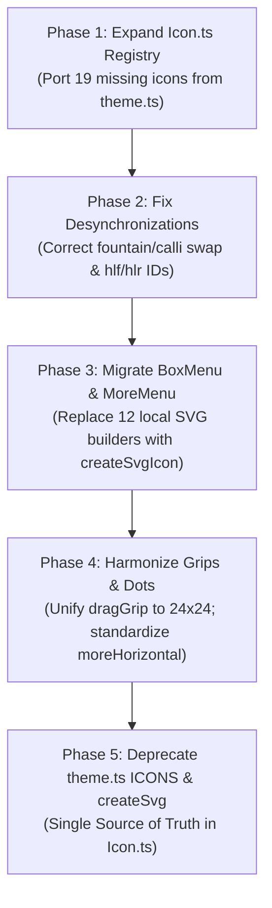

# Apolo Canvas 2.0 – Comprehensive Iconography Audit & Visual Asset Inventory

**Audit Date:** 2026-10-21  
**Project:** Apolo Canvas (Obsidian Plugin)  
**Scope:** `src/ui/`, `src/editor/`, `src/engine/`, `src/main.ts`, `sandbox/`, `styles.css`  
**Governing Principle:** Architecture Rule 8 (Unified 24px icon registry, 1.8 stroke, round caps, zero direct markup assignment, zero `innerHTML`).

---

## A. Executive Summary

This audit catalogs all visual icons, sprites, glyphs, unicode fallbacks, and procedural previews across the Apolo Canvas codebase.

### Asset Distribution Overview
Across the codebase, **101 visual asset definitions and rendering mechanisms** were cataloged, representing **74 distinct UI action roles**.

```
┌─────────────────────────────────────────────────────────────┬────────┐
│ Asset Category                                              │ Count  │
├─────────────────────────────────────────────────────────────┼────────┤
│ Centralized SVG Kit Registry (`src/ui/kit/Icon.ts`)         │   32   │
│ Legacy / Secondary SVG Registry (`src/ui/theme.ts` ICONS)   │   43   │
│ Component-Local Inline SVG Builders (BoxMenu, Drawer, etc.) │   14   │
│ Dynamic / Procedural Previews (Stroke wave, shapes, canvas) │    5   │
│ Unicode / Character Glyphs used as UI controls & dividers   │    4   │
│ Obsidian Native / Lucide Icons (`view.addAction`, Setting)  │    3   │
├─────────────────────────────────────────────────────────────┼────────┤
│ Total Visual Asset Manifestations Cataloged                 │  101   │
└─────────────────────────────────────────────────────────────┴────────┘
```

### Key Architectural Findings

1. **Dual-Registry Architecture (Fragmented Source of Truth):**
   - The plugin currently maintains two separate icon registries: `src/ui/kit/Icon.ts` (32 pure DOM SVG definitions conforming to Architecture Rule 8) and `src/ui/theme.ts` (43 string-based SVG path definitions used via `createSvg`).
   - 19 icons in `theme.ts` (including `feather`, `ballpoint`, `pencil`, `highlighterChisel`, `highlighterRound`, `bookmark`, `star`, `clock`, `plusCircle`, `eyedropper`, `copy`, `paste`, `bringToFront`, `sendToBack`, `sliders`, `chevronLeft`, `chevronRight`) have not yet been ported to `Icon.ts`.

2. **Critical Desynchronization Bug (Fountain vs Calligraphic Inversion):**
   - In `ToolEstuche.ts` and `PenEstuchePopover.ts`, `fountain` (Estilográfica) maps to `ICONS.pen` (fountain nib), while `calli` (Caligráfica) maps to `ICONS.feather` (quill feather).
   - In `FavoritesDrawer.ts` (`getPresetIcon`), this mapping is **reversed**: `fountain` returns `ICONS.feather` and `calli` returns `ICONS.pen`. A preset saved as an Estilográfica in the estuche displays with a feather icon in the favorites drawer.

3. **Local SVG Sprawl in `BoxMenu.ts`:**
   - `BoxMenu.ts` does not consume `Icon.ts` or `theme.ts`. Instead, it defines 11 private SVG generation functions (`createDotsSvg`, `createGridSvg`, `createRuledSvg`, `createBlankSvg`, `createCloseSvg`, `createCompressSvg`, `createEraserSvg`, `createTrashSvg`, `createDensityDenseSvg`, `createDensityMediumSvg`, `createDensitySparseSvg`) via manual DOM manipulation, diverging from central design tokens.

4. **Multiple Inconsistent Grip and Dot Implementations:**
   - **Drag Grips:** Three separate variants exist with three different coordinate systems and viewBoxes: `Toolbar.ts` uses `ICONS.dragGrip` (viewBox `0 0 14 14`), `FavoritesDrawer.ts` uses `create6DotGripSvg` (viewBox `0 0 16 16`), and `Icon.ts` defines `dragGrip` (viewBox `0 0 24 24`).
   - **Dots / Options:** Four distinct dot representations exist: 3 horizontal dots (`createDotsIcon` in `theme.ts`), 3-dot path (`ICONS.more`), 4-dot 2x2 grid (`Icon.ts` `dots`), and 9-dot 3x3 matrix (`BoxMenu.ts` `createDotsSvg`).

5. **Zero-`innerHTML` Compliance:**
   - Source code in `src/` strictly honors the zero-`innerHTML` rule. Icon creation utilizes `document.createElementNS('http://www.w3.org/2000/svg', ...)` or the safe regex parser `createSvgFromMarkup` in `theme.ts`. `innerHTML` is only used inside `sandbox/index.html` for offline benchmark harness rendering.

---

## B. Component-by-Component Icon Inventory Table

| Component / File | UI Action / Role | Current Implementation | Glyph / Identifier | Status | Observations & Alignment with Design System |
| :--- | :--- | :--- | :--- | :--- | :--- |
| **Toolbar** (`src/ui/Toolbar.ts`) | Drag grip / reorder handle | `createSvg(ICONS.dragGrip)` | `ICONS.dragGrip` | `Pending Upgrade` | Defined in `theme.ts` as raw HTML `<circle...>`, rendered with custom `viewBox: 0 0 14 14`. Needs migration to `createSvgIcon('dragGrip')` (24x24). |
| **Toolbar** (`src/ui/Toolbar.ts`) | Keyboard / stylus cursor mode | `createSvg(ICONS.keyboardMode)` | `ICONS.keyboardMode` | `Ready` | Standard 24x24 linear glyph (`M9 4h6...`). Registered in both `theme.ts` and `Icon.ts`. |
| **Toolbar** (`src/ui/Toolbar.ts`) | Core tool: Pen | `createSvg(ICONS.pen)` | `ICONS.pen` | `Ready` | 24x24 linear nib icon. Present in `Icon.ts` and `theme.ts`. |
| **Toolbar** (`src/ui/Toolbar.ts`) | Core tool: Highlighter | `createSvg(ICONS.highlighter)` | `ICONS.highlighter` | `Ready` | 24x24 linear chisel marker. Present in `Icon.ts` and `theme.ts`. |
| **Toolbar** (`src/ui/Toolbar.ts`) | Core tool: Eraser | `createSvg(ICONS.eraser)` | `ICONS.eraser` | `Ready` | 24x24 linear eraser. Present in `Icon.ts` and `theme.ts`. |
| **Toolbar** (`src/ui/Toolbar.ts`) | Core tool: Lasso | `createSvg(ICONS.lasso, { dash })` | `ICONS.lasso` | `Ready` | 24x24 dashed lasso loop (`stroke-dasharray: 3 2.5`). Present in `Icon.ts` and `theme.ts`. |
| **Toolbar** (`src/ui/Toolbar.ts`) | Core tool: Active Shape | `createSvg(getShapeIcon(shape))` | `ICONS.shapes[shape]` | `Ready` | Dynamically renders rect, line, arrow, circle, or triangle. All 5 registered in `Icon.ts`. |
| **Toolbar** (`src/ui/Toolbar.ts`) | Insert Canvas Block | `createSvg(ICONS.insertCanvas)` | `ICONS.insertCanvas` | `Ready` | 24x24 note outline with inner plus icon. Present in `Icon.ts` and `theme.ts`. |
| **Toolbar** (`src/ui/Toolbar.ts`) | Undo action | `createSvg(ICONS.undo)` | `ICONS.undo` | `Ready` | 24x24 curved counter-clockwise arrow. Present in `Icon.ts` and `theme.ts`. |
| **Toolbar** (`src/ui/Toolbar.ts`) | Redo action | `createSvg(ICONS.redo)` | `ICONS.redo` | `Ready` | 24x24 curved clockwise arrow. Present in `Icon.ts` and `theme.ts`. |
| **Toolbar** (`src/ui/Toolbar.ts`) | Dynamic Color Slots (4 slots) | CSS element | `.apolo-color-dot` | `Ready` | Pure CSS circular color indicator with background color. No SVG required. |
| **Toolbar** (`src/ui/Toolbar.ts`) | Thickness Popover Trigger | CSS element | `.apolo-thickness-line-preview` | `Ready` | Pure CSS dot representing current active stroke width. |
| **Toolbar** (`src/ui/Toolbar.ts`) | Snap-to-Grid toggle | `createSvg(ICONS.grid)` | `ICONS.grid` | `Ready` | 24x24 2x2 grid icon. Present in `Icon.ts` and `theme.ts`. |
| **Toolbar** (`src/ui/Toolbar.ts`) | More Menu Trigger | *Not Rendered* | `ICONS.more` | `Pending Upgrade` | `onToggleMoreMenu` is defined in `ToolbarOptions` and `ICONS.more` exists in `theme.ts`, but no button is instantiated in the Toolbar DOM. |
| **ToolEstuche** (`src/ui/ToolEstuche.ts`) | Header Bookmark (Open Drawer) | `createSvg(ICONS.bookmark)` | `ICONS.bookmark` | `Pending Upgrade` | 18x18 SVG bookmark from `theme.ts`. Missing in `Icon.ts`. |
| **ToolEstuche** (`src/ui/ToolEstuche.ts`) | Header Star (Toggle Favorite) | `createSvg(ICONS.star)` | `ICONS.star` | `Pending Upgrade` | 18x18 SVG star from `theme.ts`. Named `favorite` in `Icon.ts`; should be unified. |
| **ToolEstuche** (`src/ui/ToolEstuche.ts`) | Header Close Button | `createSvg(ICONS.close)` | `ICONS.close` | `Ready` | 16x16 SVG close cross from `theme.ts`. Matches `Icon.ts` `close`. |
| **ToolEstuche** (`src/ui/ToolEstuche.ts`) | Profile Pager Prev Chevron | `createSvg(ICONS.chevronLeft)` | `ICONS.chevronLeft` | `Pending Upgrade` | 12x12 chevron from `theme.ts`. Missing in `Icon.ts` (only `chevronDown`/`chevronUp` exist). |
| **ToolEstuche** (`src/ui/ToolEstuche.ts`) | Profile Pager Next Chevron | `createSvg(ICONS.chevronRight)` | `ICONS.chevronRight` | `Pending Upgrade` | 12x12 chevron from `theme.ts`. Missing in `Icon.ts`. |
| **ToolEstuche** (`src/ui/ToolEstuche.ts`) | Add Profile Dot | `createSvg(ICONS.plus)` | `ICONS.plus` | `Ready` | Scaled 10x10 plus icon (`strokeWidth: 2.2`). |
| **ToolEstuche** (`src/ui/ToolEstuche.ts`) | Pen Tip: Fountain (`fountain`) | `createSvg(ICONS.pen)` | `ICONS.pen` | `Pending Upgrade` | Uses 22x22 `ICONS.pen`. Missing dedicated profile entry in `Icon.ts`. Desynchronized with `FavoritesDrawer`. |
| **ToolEstuche** (`src/ui/ToolEstuche.ts`) | Pen Tip: Calligraphic (`calli`) | `createSvg(ICONS.feather)` | `ICONS.feather` | `Pending Upgrade` | Uses 22x22 `ICONS.feather`. Missing in `Icon.ts`. Desynchronized with `FavoritesDrawer`. |
| **ToolEstuche** (`src/ui/ToolEstuche.ts`) | Pen Tip: Ballpoint (`ball`) | `createSvg(ICONS.ballpoint)` | `ICONS.ballpoint` | `Pending Upgrade` | Uses 22x22 `ICONS.ballpoint`. Missing in `Icon.ts`. |
| **ToolEstuche** (`src/ui/ToolEstuche.ts`) | Pen Tip: Pencil (`pencil`) | `createSvg(ICONS.pencil)` | `ICONS.pencil` | `Pending Upgrade` | Uses 22x22 `ICONS.pencil`. Missing in `Icon.ts`. |
| **ToolEstuche** (`src/ui/ToolEstuche.ts`) | Highlighter: Chisel (`hlf`) | `createSvg(ICONS.highlighterChisel)` | `ICONS.highlighterChisel` | `Pending Upgrade` | Uses 22x22 `ICONS.highlighterChisel`. Missing in `Icon.ts`. |
| **ToolEstuche** (`src/ui/ToolEstuche.ts`) | Highlighter: Round (`hlr`) | `createSvg(ICONS.highlighterRound)` | `ICONS.highlighterRound` | `Pending Upgrade` | Uses 22x22 `ICONS.highlighterRound`. Missing in `Icon.ts`. |
| **ToolEstuche** (`src/ui/ToolEstuche.ts`) | Stepper Minus (`-`) | `createSvg(ICONS.minus)` | `ICONS.minus` | `Ready` | 14x14 minus line. Present in `Icon.ts` and `theme.ts`. |
| **ToolEstuche** (`src/ui/ToolEstuche.ts`) | Stepper Plus (`+`) | `createSvg(ICONS.plus)` | `ICONS.plus` | `Ready` | 14x14 plus cross. Present in `Icon.ts` and `theme.ts`. |
| **ToolEstuche** (`src/ui/ToolEstuche.ts`) | Line Styles (Solid, Dash, Dot) | HTML / CSS Divs | `.popover-line-bar` | `Pending Upgrade` | Rendered with CSS borders and radial gradients instead of SVG vector lines. |
| **ToolEstuche** (`src/ui/ToolEstuche.ts`) | Straighten lines toggle | CSS Switch | `.popover-switch` | `Ready` | Accessible toggle switch with CSS transition. |
| **ToolEstuche** (`src/ui/ToolEstuche.ts`) | Palette Add Custom Color | `createSvg(ICONS.plus)` | `ICONS.plus` | `Ready` | 14x14 plus icon in swatch ring. |
| **ToolEstuche** (`src/ui/ToolEstuche.ts`) | Palette Recent History | `createSvg(ICONS.clock)` | `ICONS.clock` | `Pending Upgrade` | 14x14 clock glyph from `theme.ts`. Missing in `Icon.ts`. |
| **ToolEstuche** (`src/ui/ToolEstuche.ts`) | Eraser Mode Selectors | CSS Elements | `.eraser-radio-circle` | `Pending Upgrade` | Generic radio dots without visual stroke vs reticle icons. |
| **ToolEstuche** (`src/ui/ToolEstuche.ts`) | Eraser Size Indicator | CSS Element | `.eraser-preview-dot` | `Ready` | Dynamic circular preview scaling from 12px to 36px based on radius. |
| **ToolEstuche** (`src/ui/ToolEstuche.ts`) | Lasso Mode Selectors | CSS Elements | `.eraser-radio-circle` | `Pending Upgrade` | Generic radio dots without visual freeform vs rectangular lasso icons. |
| **FavoritesDrawer** (`src/ui/favorites/FavoritesDrawer.ts`) | Pager Prev Chevron | `createSvg(ICONS.chevronLeft)` | `ICONS.chevronLeft` | `Pending Upgrade` | 12x12 chevron from `theme.ts`. Missing in `Icon.ts`. |
| **FavoritesDrawer** (`src/ui/favorites/FavoritesDrawer.ts`) | Pager Next Chevron | `createSvg(ICONS.chevronRight)` | `ICONS.chevronRight` | `Pending Upgrade` | 12x12 chevron from `theme.ts`. Missing in `Icon.ts`. |
| **FavoritesDrawer** (`src/ui/favorites/FavoritesDrawer.ts`) | Add Profile Plus | `createSvg(ICONS.plus)` | `ICONS.plus` | `Ready` | 8x8 plus icon. |
| **FavoritesDrawer** (`src/ui/favorites/FavoritesDrawer.ts`) | Drawer Header Bookmark | `createSvg(ICONS.bookmark)` | `ICONS.bookmark` | `Pending Upgrade` | 18x18 bookmark from `theme.ts`. Missing in `Icon.ts`. |
| **FavoritesDrawer** (`src/ui/favorites/FavoritesDrawer.ts`) | Modal Cancel Close | `createSvg(ICONS.close)` | `ICONS.close` | `Ready` | 14x14 close icon. |
| **FavoritesDrawer** (`src/ui/favorites/FavoritesDrawer.ts`) | Modal Create Check | `createSvg(ICONS.check)` | `ICONS.check` | `Ready` | 14x14 checkmark icon. |
| **FavoritesDrawer** (`src/ui/favorites/FavoritesDrawer.ts`) | Empty State Bookmark Icon | `createSvg(ICONS.bookmark)` | `ICONS.bookmark` | `Pending Upgrade` | 28x28 large empty state bookmark. Missing in `Icon.ts`. |
| **FavoritesDrawer** (`src/ui/favorites/FavoritesDrawer.ts`) | Empty State Inline Star | `createSvg(ICONS.star)` | `ICONS.star` | `Pending Upgrade` | 13x13 star appended inline inside description text node. |
| **FavoritesDrawer** (`src/ui/favorites/FavoritesDrawer.ts`) | Card Preset Tool Glyph | `createSvg(getPresetIcon(preset))` | `getPresetIcon` | `Pending Upgrade` | **Critical Bug:** Inverted mapping for `fountain` (returns `feather`) and `calli` (returns `pen`). |
| **FavoritesDrawer** (`src/ui/favorites/FavoritesDrawer.ts`) | Card Drag Handle | `create6DotGripSvg()` | Local SVG builder | `Pending Upgrade` | Hardcoded 16x16 SVG (`viewBox: 0 0 16 16`, 6 circles). Diverges from `Icon.ts` `dragGrip` (24x24). |
| **FavoritesDrawer** (`src/ui/favorites/FavoritesDrawer.ts`) | Card Rename Button | `createSvg(ICONS.pencil)` | `ICONS.pencil` | `Pending Upgrade` | 14x14 pencil glyph from `theme.ts`. Missing in `Icon.ts`. |
| **FavoritesDrawer** (`src/ui/favorites/FavoritesDrawer.ts`) | Card Delete Button | `createSvg(ICONS.trash)` | `ICONS.trash` | `Ready` | 14x14 trash icon. |
| **FavoritesDrawer** (`src/ui/favorites/FavoritesDrawer.ts`) | Stroke Preset Live Preview | Procedural SVG | `createStrokeWavePreview` | `Ready` | Pure DOM cubic Bezier curve scaled to 150x40 with color, width, opacity, and pattern. |
| **FavoritesDrawer** (`src/ui/favorites/FavoritesDrawer.ts`) | Shape Preset Live Preview | Procedural SVG | `createShapePresetPreview` | `Ready` | Pure DOM vector preview for line, arrow, ellipse, rect, triangle, and diamond. |
| **LassoMenu** (`src/ui/LassoMenu.ts`) | Anchor Block Pill Bookmark | `createSvg(ICONS.bookmark)` | `ICONS.bookmark` | `Pending Upgrade` | 12x12 bookmark icon. Missing in `Icon.ts`. |
| **LassoMenu** (`src/ui/LassoMenu.ts`) | Link Card Header Icon | `createSvg(ICONS.link)` | `ICONS.link` | `Ready` | 16x16 link chain icon with `#6C3FD1` accent stroke. |
| **LassoMenu** (`src/ui/LassoMenu.ts`) | Floating Action: Copiar | `createSvg(ICONS.copy)` | `ICONS.copy` | `Pending Upgrade` | 15x15 copy sheets glyph from `theme.ts`. Missing in `Icon.ts`. |
| **LassoMenu** (`src/ui/LassoMenu.ts`) | Floating Action: Pegar | `createSvg(ICONS.paste)` | `ICONS.paste` | `Pending Upgrade` | 15x15 clipboard glyph from `theme.ts`. Missing in `Icon.ts`. |
| **LassoMenu** (`src/ui/LassoMenu.ts`) | Floating Action: Enlazar | `createSvg(ICONS.link)` | `ICONS.link` | `Ready` | 15x15 link icon with `.is-accent-link` purple styling. |
| **LassoMenu** (`src/ui/LassoMenu.ts`) | Floating Action: Al frente | `createSvg(ICONS.bringToFront)` | `ICONS.bringToFront` | `Pending Upgrade` | 15x15 upward arrow with ceiling bar from `theme.ts`. Missing in `Icon.ts`. |
| **LassoMenu** (`src/ui/LassoMenu.ts`) | Floating Action: Al fondo | `createSvg(ICONS.sendToBack)` | `ICONS.sendToBack` | `Pending Upgrade` | 15x15 downward arrow with floor bar from `theme.ts`. Missing in `Icon.ts`. |
| **LassoMenu** (`src/ui/LassoMenu.ts`) | Floating Action: Estilo | `createSvg(ICONS.sliders)` | `ICONS.sliders` | `Pending Upgrade` | 15x15 equalizer sliders glyph from `theme.ts`. Missing in `Icon.ts`. |
| **LassoMenu** (`src/ui/LassoMenu.ts`) | Floating Action: Eliminar | `createSvg(ICONS.trash)` | `ICONS.trash` | `Ready` | 15x15 trash glyph with `.is-danger` red hover state. |
| **LassoMenu** (`src/ui/LassoMenu.ts`) | Style Popover Pattern Chips | Plain text | 'Continuo', 'Guiones', 'Puntos' | `Pending Upgrade` | Text-only chips without vector line pattern preview. |
| **ColorPickerPopover** (`src/ui/popover/ColorPickerPopover.ts`) | Mode Tabs: Muestras / Espectro | Plain text | 'Muestras', 'Espectro' | `Ready` | Accessible text tabs. |
| **ColorPickerPopover** (`src/ui/popover/ColorPickerPopover.ts`) | Eyedropper Button | `createSvg(ICONS.eyedropper)` | `ICONS.eyedropper` | `Pending Upgrade` | 18x18 eyedropper pipette glyph from `theme.ts`. Missing in `Icon.ts`. |
| **ColorPickerPopover** (`src/ui/popover/ColorPickerPopover.ts`) | Actions Divider | Unicode character | `'\|'` | `Pending Upgrade` | Literal pipe string used as a visual divider; should use CSS vertical border. |
| **ColorPickerPopover** (`src/ui/popover/ColorPickerPopover.ts`) | Action Buttons | Plain text | 'Cancelar', 'Listo' | `Ready` | Accessible text action buttons. |
| **ColorPickerPopover** (`src/ui/popover/ColorPickerPopover.ts`) | Spectrum Canvas | 2D HTML5 Canvas | Procedural Gradient | `Ready` | Dynamic 280x160 2D canvas with multi-stop rainbow and saturation gradients. |
| **ThicknessPopover** (`src/ui/popover/ThicknessPopover.ts`) | Stepper Minus (`-`) | `createSvg(ICONS.minus)` | `ICONS.minus` | `Ready` | 16x16 minus icon. |
| **ThicknessPopover** (`src/ui/popover/ThicknessPopover.ts`) | Stepper Plus (`+`) | `createSvg(ICONS.plus)` | `ICONS.plus` | `Ready` | 16x16 plus icon. |
| **BoxMenu** (`src/ui/BoxMenu.ts`) | Close Header Button | `createCloseSvg()` | Local SVG builder | `Pending Upgrade` | Hardcoded DOM lines (`strokeWidth: 2.5`). Should use `createSvgIcon('close')`. |
| **BoxMenu** (`src/ui/BoxMenu.ts`) | Fondo Tile: Dots | `createDotsSvg()` | Local SVG builder | `Pending Upgrade` | Hardcoded 9-dot matrix (`viewBox: 0 0 24 24`). Diverges from `Icon.ts` `dots` (4 dots). |
| **BoxMenu** (`src/ui/BoxMenu.ts`) | Fondo Tile: Grid | `createGridSvg()` | Local SVG builder | `Pending Upgrade` | Hardcoded rect + 4 lines. Diverges from `Icon.ts` `gridTile` (4 lines without rect). |
| **BoxMenu** (`src/ui/BoxMenu.ts`) | Fondo Tile: Ruled | `createRuledSvg()` | Local SVG builder | `Pending Upgrade` | Hardcoded 3 horizontal lines (`y=7, 12, 17`). Should use `createSvgIcon('ruled')`. |
| **BoxMenu** (`src/ui/BoxMenu.ts`) | Fondo Tile: Blank | `createBlankSvg()` | Local SVG builder | `Pending Upgrade` | Hardcoded solid rounded rect (`rx=4`). Diverges from `Icon.ts` `blank` (dashed rect). |
| **BoxMenu** (`src/ui/BoxMenu.ts`) | Density: Fina (40px) | `createDensityDenseSvg()` | Local SVG builder | `Pending Upgrade` | Hardcoded 4 horizontal lines. Missing in `Icon.ts`. |
| **BoxMenu** (`src/ui/BoxMenu.ts`) | Density: Normal (32px) | `createDensityMediumSvg()` | Local SVG builder | `Pending Upgrade` | Hardcoded 3 horizontal lines. Missing in `Icon.ts`. |
| **BoxMenu** (`src/ui/BoxMenu.ts`) | Density: Amplia (24px) | `createDensitySparseSvg()` | Local SVG builder | `Pending Upgrade` | Hardcoded 2 horizontal lines. Missing in `Icon.ts`. |
| **BoxMenu** (`src/ui/BoxMenu.ts`) | Action: Ajustar altura | `createCompressSvg()` | Local SVG builder | `Pending Upgrade` | Hardcoded vertical compress arrows. Diverges from `Icon.ts` `compress` (4 corner arrows). |
| **BoxMenu** (`src/ui/BoxMenu.ts`) | Action: Limpiar trazos | `createEraserSvg()` | Local SVG builder | `Pending Upgrade` | Hardcoded angled rubber eraser (`M19 19...`). Diverges from `Icon.ts` `eraser` (`M5 14...`). |
| **BoxMenu** (`src/ui/BoxMenu.ts`) | Action: Eliminar caja | `createTrashSvg()` | Local SVG builder | `Pending Upgrade` | Hardcoded Lucide trash (`M19 7...`). Diverges from `Icon.ts` `trash` (`M3 6...`). |
| **Box Ghost Trigger** (`ApoloSpaceExtension.ts`, `CanvasController.ts`, `main.ts`) | 3-Dots Ghost Button | `createDotsIcon()` | `createDotsIcon` (`theme.ts`) | `Pending Upgrade` | 3 horizontal circles (`cx: 5, 12, 19`). Missing in `Icon.ts` (where `dots` is a 2x2 grid). |
| **MoreMenu** (`src/ui/MoreMenu.ts`) | Close Header Button | `createSvg('M6 6L18 18...')` | Inline Path String | `Pending Upgrade` | Hardcoded SVG string with `strokeWidth: 2.5`. Should use `createSvgIcon('close')`. |
| **ZoomPill** (`src/ui/ZoomPill.ts`) | Zoom Out Minus (`-`) | `createSvgIcon('minus')` | `Icon.ts` | `Ready` | UI Kit pure DOM SVG button (`size: 16`). |
| **ZoomPill** (`src/ui/ZoomPill.ts`) | Zoom In Plus (`+`) | `createSvgIcon('plus')` | `Icon.ts` | `Ready` | UI Kit pure DOM SVG button (`size: 16`). |
| **UI Kit Shell** (`src/ui/kit/PopoverShell.ts`) | Popover Shell Close | `createSvgIcon('close')` | `Icon.ts` | `Ready` | UI Kit pure DOM SVG button (`size: 18`). |
| **UI Kit ActionRow** (`src/ui/kit/ActionRow.ts`) | Action Row Icon | `createSvgIcon(item.icon)` | `Icon.ts` | `Ready` | UI Kit pure DOM SVG button (`size: 18`). |
| **UI Kit OptionCard** (`src/ui/kit/OptionCard.ts`) | Card Header Icon | `createSvgIcon(options.icon)` | `Icon.ts` | `Ready` | UI Kit pure DOM SVG element (`size: 18`). |
| **Obsidian Settings** (`src/main.ts`) | Delete Profile Extra Button | `btn.setIcon('trash')` | Obsidian Native | `Ready` | Obsidian native Lucide icon registration. |
| **Obsidian Settings** (`src/main.ts`) | Add Profile CTA Button | `btn.setButtonText('+ Añadir')` | Unicode character | `Pending Upgrade` | Literal `+` in button label; should use standard Obsidian/Apolo icon button. |
| **Obsidian View Header** (`src/main.ts`) | Local Graph Action | `view.addAction('git-fork', ...)` | Obsidian Native | `Ready` | Obsidian native Lucide icon registration. |
| **Obsidian View Header** (`src/main.ts`) | Companion SVG Export Action | `view.addAction('file-down', ...)` | Obsidian Native | `Ready` | Obsidian native Lucide icon registration. |

---

## C. Pending & Inconsistent Assets (Action List)

### 1. Emojis and Character Glyphs Needing Proper Replacements

| Location | Current Glyph / Character | Proposed Replacement | Rationale & Impact |
| :--- | :--- | :--- | :--- |
| `src/main.ts:1511` | Text button `'+ Añadir'` | UI Kit `plus` icon (`createSvgIcon('plus', { size: 14 })`) or Obsidian `setIcon('plus')` | Literal `+` renders with varying system font metrics across OSs (Windows Segoe UI vs macOS San Francisco vs Android Roboto). An SVG icon guarantees consistent geometry. |
| `src/ui/popover/ColorPickerPopover.ts:267` | Text divider `dividerSpan.textContent = '\|'` | CSS border (`border-right: 1px solid var(--apolo-border-subtle)`) | Using a text pipe character causes baseline alignment shifts and screen reader pronunciation issues ("vertical line"). |
| `src/ui/LassoMenu.ts:386-390` | Text-only pattern chips ('Continuo', 'Guiones', 'Puntos') | Mini vector pattern lines (similar to `ToolEstuche` line grid) | Users selecting stroke patterns in the Lasso popover should see the actual visual dashed/dotted representation, not plain text. |
| `src/ui/ToolEstuche.ts:1210-1239` & `src/ui/estuche/EraserEstuchePopover.ts` | CSS radio dot for Eraser Modes ('Completo' vs 'Área') | Dedicated SVG glyphs for Stroke Eraser (diagonal eraser striking a stroke) and Area/Reticle Eraser (eraser with reticle target) | Current radio button design provides no visual metaphor distinguishing the two erasing paradigms. |
| `src/ui/ToolEstuche.ts:1374-1403` | CSS radio dot for Lasso Modes ('Libre' vs 'Rectangular') | Dedicated SVG glyphs for Free Lasso (dashed lasso curve) and Rectangular Lasso (dashed rectangle with crosshair corner) | Replaces generic radio dots with standard vector selection metaphors. |

---

### 2. Duplicated or Desynchronized Paths

#### A. Critical Tool Preset Icon Inversion
- **Issue:** `FavoritesDrawer.ts` has an inverted mapping compared to `ToolEstuche.ts` and `PenEstuchePopover.ts`:
  ```ts
  // src/ui/ToolEstuche.ts & src/ui/estuche/PenEstuchePopover.ts
  { id: 'fountain', label: 'Estilográfica', iconD: ICONS.pen },
  { id: 'calli',    label: 'Caligráfica',   iconD: ICONS.feather },

  // src/ui/favorites/FavoritesDrawer.ts (getPresetIcon)
  case 'fountain': return ICONS.feather; // BUG: Inverted!
  case 'calli':    return ICONS.pen;     // BUG: Inverted!
  ```
- **Consequence:** Users select a fountain pen (nib) in the estuche, but it saves and renders as a calligraphy feather in their favorites shelf.
- **Fix:** Align `FavoritesDrawer.ts` to return `ICONS.pen` for `fountain` and `ICONS.feather` for `calli`.

#### B. Highlighter Profile ID Inconsistency
- In `HighlighterEstuchePopover.ts`, profile IDs are defined as `chisel` and `round`:
  ```ts
  { id: 'chisel', label: 'Marcador Biselado', iconD: ICONS.highlighterChisel },
  { id: 'round',  label: 'Marcador Redondo',  iconD: ICONS.highlighterRound }
  ```
- In `ToolEstuche.ts`, `theme.ts`, and `FavoritesDrawer.ts`, profile IDs are `hlf` (flat/chisel) and `hlr` (round):
  ```ts
  case 'hlf': return ICONS.highlighterChisel;
  case 'hlr': return ICONS.highlighterRound;
  ```
- **Consequence:** Presets created from `HighlighterEstuchePopover.ts` will not match `FavoritesDrawer.ts` icons or `PEN_PROFILES` multipliers.
- **Fix:** Standardize all highlighter identifiers across the entire codebase to `hlf` and `hlr`.

#### C. Path Divergence between `Icon.ts`, `theme.ts`, and `BoxMenu.ts`

| Icon Name | `Icon.ts` Implementation | `theme.ts` Implementation | `BoxMenu.ts` Implementation |
| :--- | :--- | :--- | :--- |
| **Trash** | Flat lid with rectangular bin & vertical slats (`M3 6h18 M19 6v14...`) | Lucide angled lid with tapered bin (`M19 7l-.867 12.142A2 2...`) | Lucide angled lid with tapered bin (`M19 7l-.867 12.142A2 2...`) |
| **Eraser** | Flat angled body with horizontal base line (`M5 14l8-8 6 6-6 6H9z M7 20h12`) | Identical to `Icon.ts` (`M5 14l8-8 6 6-6 6H9z M7 20h12`) | Dual-band angled rubber eraser (`M19 19H8l-5-5a2.8 2.8 0 010-4l7-7...`) |
| **Compress** | 4 inward diagonal corner arrows (`M4 14h6v6 M20 10h-6V4...`) | *Not Defined* | 2 vertical meeting arrows with center horizontal bar (`M12 3v6... M12 21v-6... M4 12h16`) |
| **Close** | 2 lines (6,6 to 18,18 and 18,6 to 6,18), `strokeWidth: 1.8` | Path `M6 6l12 12 M18 6L6 18`, `strokeWidth: 1.8` | 2 lines, hardcoded `strokeWidth: 2.5` (BoxMenu) & inline path `strokeWidth: 2.5` (MoreMenu) |
| **Star / Favorite** | Path `M12 2l3.09 6.26L22 9.27...` (keyed as `favorite`) | Path `M12 2l3.09 6.26L22 9.27...` (keyed as `star`) | *Not Defined* |

- **Fix:** Migrate `BoxMenu.ts` and `MoreMenu.ts` to consume `Icon.ts` directly, and unify key naming (`star` as alias of `favorite`).

---

### 3. Scaling & ViewBox Misalignments

#### A. Three Distinct Drag Grip Definitions
1. `src/ui/theme.ts`: `ICONS.dragGrip` defines raw HTML circles at `cx="4", "10"` and `cy="3", "7", "11"`. Rendered in `Toolbar.ts` with explicit `viewBox: 0 0 14 14`.
2. `src/ui/favorites/FavoritesDrawer.ts`: `create6DotGripSvg` defines 6 circles at `cx="5", "11"` and `cy="4", "8", "12"` with `viewBox: 0 0 16 16`.
3. `src/ui/kit/Icon.ts`: `dragGrip` defines 6 circles at `cx="8", "16"` and `cy="6", "12", "18"` with standard `viewBox: 0 0 24 24`.
- **Harmonization Strategy:** Retire the 14x14 and 16x16 variants. All components should use `createSvgIcon('dragGrip')` on the unified 24x24 grid.

#### B. Four Distinct Dot Matrix / More Options Icons
1. `src/ui/theme.ts` `createDotsIcon()`: 3 horizontal circles (`cx: 5, 12, 19, cy: 12`) in a 24x24 viewBox, manually forced to 16x16 size in DOM.
2. `src/ui/theme.ts` `ICONS.more`: Path string `M5 12h.01 M12 12h.01 M19 12h.01` (3 horizontal dots).
3. `src/ui/kit/Icon.ts` `dots`: 4 circles in a 2x2 grid (`cx: 7, 17, cy: 7, 17`).
4. `src/ui/BoxMenu.ts` `createDotsSvg()`: 9 circles in a 3x3 grid (`cx, cy: 6, 12, 18`).
- **Harmonization Strategy:**
  - Rename `Icon.ts` `dots` (2x2 grid) to `dotsGrid` or `quadDots`.
  - Add `moreHorizontal` (3 horizontal dots) to `Icon.ts` to replace `createDotsIcon()` and `ICONS.more`.
  - Add `dotsGrid3x3` (9 dots) to `Icon.ts` to replace `createDotsSvg()`.

#### C. Inconsistent Stroke Widths
- The design system standard is `strokeWidth: 1.8` with `stroke-linecap: round` and `stroke-linejoin: round`.
- However:
  - `BoxMenu.ts` `createCloseSvg` hardcodes `strokeWidth: 2.5`.
  - `MoreMenu.ts` close button hardcodes `strokeWidth: 2.5`.
  - `LassoMenu.ts` action buttons use `strokeWidth: 1.9`.
  - `FavoritesDrawer.ts` check buttons use `strokeWidth: 2.2`.
  - `ToolEstuche.ts` nav chevrons use `strokeWidth: 2.0`.
- **Harmonization Strategy:** Enforce default `1.8` across all icons via `IconOptions.strokeWidth`.

---

### 4. Candidates for Procedural or Dynamic Rendering

| Feature / Location | Current Static Approach | Proposed Procedural Enhancement | Benefit & User Experience |
| :--- | :--- | :--- | :--- |
| **ToolEstuche Header Trazo Live Preview** | ToolEstuche only displays a static tool icon and numeric width bubble. | Port `createStrokeWavePreview` into `ToolEstuche.ts` header or thickness section to render a live, dynamic wave preview of the currently selected pen profile, color, opacity, width, and pattern. | Gives instant tactile feedback when tweaking sliders in the estuche without needing to open the favorites drawer. |
| **ToolEstuche Line Pattern Chips** (`popover-lines-grid`) | Rendered as HTML `span` and `div` elements with CSS `border-top: dashed` and `radial-gradient` backgrounds. | Procedural inline SVG stroke segments (`<svg><line stroke-dasharray="..."/></svg>`). | Ensures pixel-perfect alignment with the actual rendering engine's SVG stroke generator in `PatternedStrokeRenderer.ts`. |
| **LassoMenu Pattern Chips** | Text-only chips: 'Continuo', 'Guiones', 'Puntos'. | Micro SVG stroke previews showing the 3 stroke styles. | Matches the visual pattern selector in the ToolEstuche and reduces cognitive load. |
| **BoxMenu Density Selector** | 3 hardcoded private functions (`createDensityDenseSvg`, etc.). | Parameterized SVG density generator: `createDensityPreviewSvg(lineCount: number)`. | Eliminates 3 duplicate functions and allows dynamic density visualization. |
| **Toolbar Dynamic Shape Icon** | Switches between 5 static shape paths (`rect`, `circle`, etc.). | Live procedural shape thumbnail reflecting the shape's active stroke color and fill settings. | The toolbar shape button immediately communicates whether stroke fill or color is currently active. |

---

## D. Consolidation & Migration Roadmap

To achieve full compliance with **Architecture Rule 8**, the following sequence of non-breaking refactoring steps is recommended:



1. **Phase 1: Expand `src/ui/kit/Icon.ts`**
   - Port all missing icons from `theme.ts` into `ICON_DEFINITIONS`: `feather`, `ballpoint`, `pencil`, `highlighterChisel`, `highlighterRound`, `bookmark`, `star`, `clock`, `plusCircle`, `eyedropper`, `copy`, `paste`, `bringToFront`, `sendToBack`, `sliders`, `chevronLeft`, `chevronRight`, `moreHorizontal`.
   - Add specialized BoxMenu icons: `compressVertical`, `dotsGrid3x3`.

2. **Phase 2: Correct Desynchronizations**
   - Fix `FavoritesDrawer.ts` `getPresetIcon`: map `fountain` -> `pen` and `calli` -> `feather`.
   - Standardize `HighlighterEstuchePopover.ts` IDs to `hlf` and `hlr`.

3. **Phase 3: Refactor Local Component SVGs**
   - Remove private SVG generators from `BoxMenu.ts` and replace with `createSvgIcon(...)`.
   - Replace MoreMenu's inline path with `createSvgIcon('close')`.

4. **Phase 4: Grip and Dot Standardization**
   - Replace 14x14 and 16x16 grip handles with standard `createSvgIcon('dragGrip')`.
   - Replace all 3-dot ghost buttons (`ApoloSpaceExtension`, `CanvasController`, `main.ts`) with `createSvgIcon('moreHorizontal')`.

5. **Phase 5: Complete `theme.ts` Deprecation**
   - Redirect `ICONS` references in `Toolbar.ts` and `ToolEstuche.ts` to `createSvgIcon`, completing the centralization of iconography under Architecture Rule 8.
